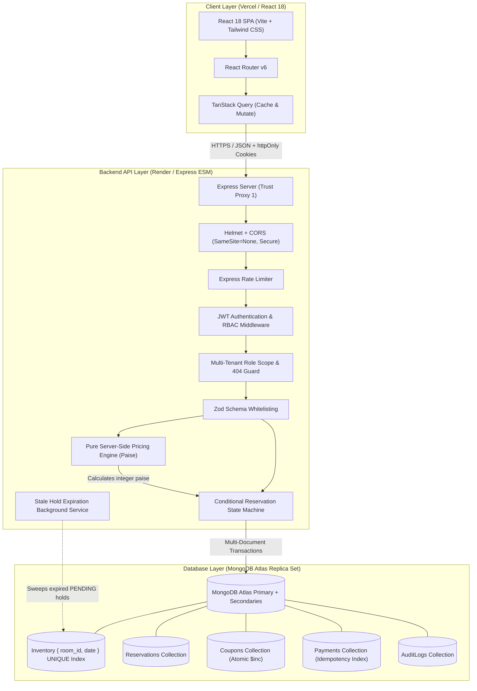
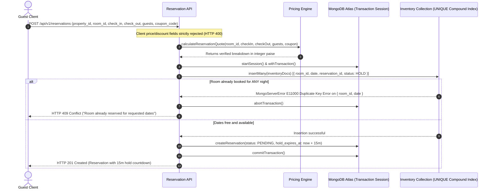
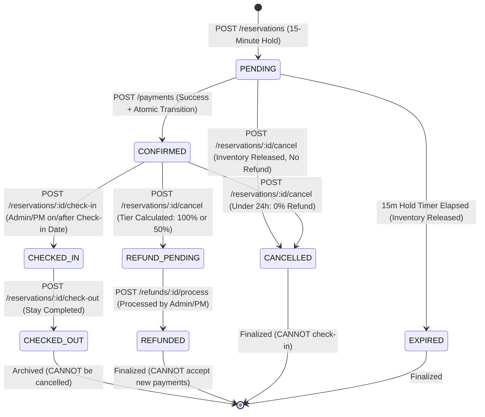

# Aura Stays – Boutique Hotel & Resort Reservation Platform

[-00ED64?style=for-the-badge&logo=mongodb)](https://www.mongodb.com/)
[](https://react.dev/)
[-339933?style=for-the-badge&logo=node.js)](https://nodejs.org/)
[](https://www.mongodb.com/cloud/atlas)
[-brightgreen?style=for-the-badge)](https://nodejs.org/api/test.html)

A high-reliability, multi-tenant Hotel & Resort Reservation Platform built for concurrency-safe room bookings, multi-tier cancellation policies, tamper-proof server-side pricing, and role-scoped administrative workflows.

---

## 🌐 Live Deployments

- **Web Application**: [https://aura-stays.vercel.app](https://aura-stays.vercel.app)
- **Backend API**: [https://aura-stays-api.onrender.com](https://aura-stays-api.onrender.com)
- **API Health Check**: [https://aura-stays-api.onrender.com/api/health](https://aura-stays-api.onrender.com/api/health)
- **API Base Route**: `https://aura-stays-api.onrender.com/api/v1`

---

## 📑 Table of Contents

1. [Architecture Overview](#-architecture-overview)
2. [Tech Stack](#-tech-stack)
3. [Local Development & Quick Start](#-local-development--quick-start)
4. [Default Seed Credentials](#-default-seed-credentials)
5. [The 8 Core Technical Challenges & Solutions](#-the-8-core-technical-challenges--solutions)
6. [Date Convention & Cancellation Policies](#-date-convention--cancellation-policies)
7. [API Endpoint Reference](#-api-endpoint-reference)
8. [Automated Test Suites](#-automated-test-suites)
9. [Production Architecture & Environment Configuration](#-production-architecture--environment-configuration)
10. [Post-Deployment Verification](#-post-deployment-verification)

---

## 🏛 Architecture Overview

### 1. High-Level Architecture



### 2. Double-Booking Prevention & Booking Flow



### 3. Reservation State Machine Lifecycle



---

## 🛠 Tech Stack

### Backend (`/server`)
- **Runtime**: Node.js v22+ with native ES Modules (`"type": "module"`).
- **Framework**: Express.js with `helmet`, `cors`, and `express-rate-limit`.
- **Database Layer**: MongoDB Atlas Multi-Document Transactions with Mongoose.
- **Authentication**: Stateless Access Tokens (15 min) + `httpOnly` Refresh Tokens (7 days) signed via `jsonwebtoken` and hashed with `bcrypt`. Fallback body refresh support for browsers blocking third-party cross-site cookies.
- **Schema Validation**: Zod with strict key whitelisting (preventing mass assignment and price injection).
- **Structured Logging**: Pino with request-level UUID correlation tracing (`x-request-id`).
- **Currency Handling**: Integer paise arithmetic (₹1.00 = 100 paise) preventing floating-point rounding errors.

### Frontend (`/client`)
- **Build Tool**: Vite 5.
- **Library**: React 18 with React Router v6.
- **State & Server Cache**: TanStack React Query v5 (query caching, invalidation, and optimistic updates).
- **Styling**: Tailwind CSS with custom natural boutique styling (deep botanical teal, warm gold accents, clean typography, dark/light theme).
- **Component Primitives**: Radix UI (Dialog, Dropdown Menu, Select, Tabs, Popover).
- **Forms & Validation**: React Hook Form with `@hookform/resolvers/zod`.
- **Charts & Data Viz**: Recharts (Occupancy metrics, revenue breakdown).
- **Notifications**: Sonner rich toasts.

---

## 💻 Local Development & Quick Start

### Prerequisites
- Node.js v20+ or v22+
- A running MongoDB Atlas cluster or local MongoDB instance

### 1. Installation
Clone the repository and install root and workspace dependencies:

```bash
git clone https://github.com/Prashant4501/Aura-Stays.git
cd Aura-Stays

npm install
npm --prefix server install
npm --prefix client install
```

### 2. Environment Setup
Copy the environment template files:

```bash
cp server/.env.example server/.env
cp client/.env.example client/.env
```

Ensure `server/.env` contains your `MONGODB_URI` connection string.

### 3. Database Seeding
Populate the database with canonical assessment data (`mock_data.json`):

```bash
npm run seed
```

### 4. Running Locally
Run both client and server concurrently:

```bash
npm run dev
```

- Frontend: `http://localhost:5173`
- Backend API: `http://localhost:5000/api/v1`
- Health check: `http://localhost:5000/api/health`

---

## 🔑 Default Seed Credentials

All seed accounts are initialized with password: `Password@123`

| User ID | Role | Name | Email | Permissions / Assigned Scope |
| :--- | :--- | :--- | :--- | :--- |
| `USR-001` | `ADMIN` | Super Admin | `admin@example.com` | Global platform administration across all properties. |
| `USR-002` | `PROPERTY_MANAGER` | Hotel Manager 1 | `manager1@example.com` | Manages **Grand Mumbai Hotel** (`PROP-001`). Scoped access only. |
| `USR-003` | `PROPERTY_MANAGER` | Hotel Manager 2 | `manager2@example.com` | Manages **Sunset Goa Resort** (`PROP-002`). Scoped access only. |
| `USR-004` | `GUEST` | Guest One | `guest1@example.com` | Standard guest account (`GST-001`). |
| `USR-005` | `GUEST` | Guest Two | `guest2@example.com` | Standard guest account (`GST-002`). |
| `USR-006` | `GUEST` | Guest Three | `guest3@example.com` | Standard guest account (`GST-003`). |

The login page includes one-click demo profile pills for instantaneous authentication.

---

## 🛡️ The 8 Core Technical Challenges & Solutions

### Challenge 1: The Double-Booking Problem
- **Risk**: Concurrent requests for the same room and overlapping dates resulting in duplicate reservations.
- **Solution**: MongoDB multi-document ACID transactions with compound unique indexes (`{ room_id: 1, date: 1 }`) on the `inventories` collection.
- **Outcome**: When concurrent requests arrive, exactly one transaction commits. The losing transactions trigger an `E11000` duplicate key error, roll back automatically, and return `409 Conflict`.

### Challenge 2: Date-Range Overlap Detection
- **Convention**: Check-in at 14:00, check-out at 11:00. Room nights are tracked on a half-open interval `[check_in_date, check_out_date)`.
- **Adjacent Stays**: Guest A checking out on Sept 25 and Guest B checking in on Sept 25 is valid and accepted with zero conflict.
- **Overlaps**: Partial overlaps, complete overlaps, and multi-day spans are blocked by the database unique index. Cancelled reservations release their dates immediately.

### Challenge 3: Server-Side Price Integrity
- **Risk**: Clients tampering with `price`, `discount`, `tax`, or `total_amount` in request payloads.
- **Solution**: The booking API strictly whitelists input fields. Injected financial fields cause immediate rejection with `400 Bad Request`. All base prices, seasonal adjustments, weekend rates, extra guest surcharges, taxes, and coupon discounts are calculated exclusively on the server in integer paise.

### Challenge 4: Coupon Abuse & Concurrency Protection
- **Enforcement**: Checks coupon existence, `ACTIVE` status, validity date windows (`valid_from` to `valid_until`), minimum booking amount, maximum discount cap, and property restrictions.
- **Race Condition Guard**: Atomically increments redemption counts using MongoDB `$inc: { times_redeemed: 1 }` with query predicate `{ times_redeemed: { $lt: usage_limit } }`. Parallel requests exceeding the limit fail atomically.

### Challenge 5: Strict Reservation State Machine
- **Valid Paths**:
  - `PENDING` → `CONFIRMED` → `CHECKED_IN` → `CHECKED_OUT`
  - `PENDING` → `CANCELLED`
  - `CONFIRMED` → `CANCELLED` → `REFUND_PENDING` → `REFUNDED`
- **Rejections**: Illegal transitions (e.g. `PENDING` → `CHECKED_IN`, checking in cancelled stays, or cancelling checked-out stays) return `409 Conflict`. Refunded stays can never accept duplicate payments.

### Challenge 6: Duplicate Payment & Idempotency
- **Mechanism**: The payment endpoint requires an `Idempotency-Key` header.
- **Protection**: Replayed requests with the same key return the cached original response without reprocessing. Concurrent payments with different keys targeting the same reservation fail because the reservation state transitions atomically to `CONFIRMED`.

### Challenge 7: Cancellation & Refund Integrity
- **Calculation**: Refunds are computed server-side based on cancellation lead time relative to check-in:
  - More than 48 hours: 100% refund (0% fee).
  - 24 to 48 hours: 50% refund (50% fee).
  - Less than 24 hours: 0% refund (100% fee).
- **Processing**: Parallel refund disbursement calls are idempotent and prevent duplicate payouts.

### Challenge 8: Unauthorized Access & IDOR Prevention
- **Privacy by Design**: Guests can only access their own reservations, payments, and refunds.
- **Anti-Enumeration**: If Guest A attempts to query Guest B's reservation or payment, the API returns `404 Not Found` (never `403`), preventing resource existence discovery.
- **Multi-Tenant Isolation**: Property managers are strictly scoped to their assigned properties and cannot view or alter other properties.

---

## 📅 Date Convention & Cancellation Policies

### Check-in / Check-out Convention
- Stays occupy nights on the interval `[check_in_date, check_out_date)`.
- **Example**: A booking from `2026-09-20` to `2026-09-25` occupies 5 nights (Sept 20, 21, 22, 23, 24). The room is fully available for a new guest checking in on `2026-09-25`.

### Cancellation Refund Tiers

| Lead Time Prior to Check-in | Refund Percentage | Cancellation Fee | Reservation Status |
| :--- | :---: | :---: | :--- |
| **> 48 Hours** | 100% | 0% | `REFUND_PENDING` → `REFUNDED` |
| **24 – 48 Hours** | 50% | 50% | `REFUND_PENDING` → `REFUNDED` |
| **< 24 Hours** | 0% | 100% | `CANCELLED` (No refund created) |

---

## 📡 API Endpoint Reference

All endpoints are prefixed with `/api/v1`.

### Public & Guest Endpoints

| Method | Endpoint | Description |
| :--- | :--- | :--- |
| `POST` | `/auth/register` | Self-register as a new guest. |
| `POST` | `/auth/login` | Authenticate and obtain JWT access token + refresh cookie. |
| `POST` | `/auth/refresh` | Refresh access token via cookie or body token. |
| `POST` | `/auth/logout` | Clear session and revoke refresh cookie. |
| `GET` | `/properties` | List active properties. |
| `GET` | `/properties/:id` | Get property details by ID. |
| `GET` | `/rooms` | Search available rooms with date range and guest capacity filters. |
| `GET` | `/rooms/:id` | Get room details, amenities, and room pricing. |
| `POST` | `/reservations/quote` | Calculate verified price breakdown without creating a reservation. |
| `POST` | `/reservations` | Reserve room with 15-minute inventory hold (`PENDING`). |
| `GET` | `/reservations` | List authenticated guest's reservations. |
| `GET` | `/reservations/:id` | Get single reservation details (IDOR-protected). |
| `POST` | `/reservations/:id/cancel` | Cancel eligible reservation and compute refund tier. |
| `POST` | `/payments` | Process payment with `Idempotency-Key` header. |
| `GET` | `/payments` | List authenticated guest's payment history. |
| `GET` | `/refunds` | List authenticated guest's refund history. |

### Administrative Endpoints (`ADMIN` & `PROPERTY_MANAGER`)

| Method | Endpoint | Allowed Roles | Description |
| :--- | :--- | :--- | :--- |
| `GET`, `POST` | `/admin/properties` | `ADMIN` | Manage properties. |
| `GET`, `PUT` | `/admin/properties/:id` | `ADMIN`, `PROPERTY_MANAGER` | View / update property details (scoped). |
| `GET`, `POST` | `/admin/rooms` | `ADMIN`, `PROPERTY_MANAGER` | List / create rooms within assigned properties. |
| `POST` | `/admin/rooms/:id/block` | `ADMIN`, `PROPERTY_MANAGER` | Block room dates for maintenance. |
| `POST` | `/admin/rooms/:id/unblock` | `ADMIN`, `PROPERTY_MANAGER` | Unblock maintenance dates. |
| `GET`, `POST` | `/admin/pricing` | `ADMIN`, `PROPERTY_MANAGER` | Configure seasonal and date-based pricing. |
| `GET`, `POST` | `/admin/coupons` | `ADMIN`, `PROPERTY_MANAGER` | Create and manage promotional discount coupons. |
| `POST` | `/reservations/:id/check-in` | `ADMIN`, `PROPERTY_MANAGER` | Check-in guest on or after check-in date. |
| `POST` | `/reservations/:id/check-out` | `ADMIN`, `PROPERTY_MANAGER` | Check-out guest and conclude stay. |
| `POST` | `/refunds/:id/process` | `ADMIN`, `PROPERTY_MANAGER` | Disburse pending refund to guest. |
| `GET` | `/admin/reports/occupancy` | `ADMIN`, `PROPERTY_MANAGER` | Aggregated occupancy metrics by property. |
| `GET` | `/admin/reports/revenue` | `ADMIN`, `PROPERTY_MANAGER` | Revenue breakdown by date and property. |
| `GET` | `/admin/audit-logs` | `ADMIN`, `PROPERTY_MANAGER` | Immutable compliance audit trail. |

---

## 🧪 Automated Test Suites

The project includes unit, integration, high-concurrency, and adversarial security test suites.

### 1. Core Test Suite (125 Tests across 17 Suites)
Runs all unit and integration tests:

```bash
npm test
```

```
# tests 125
# suites 17
# pass 125
# fail 0
```

### 2. High-Concurrency Stress Test
Stress-tests transactional locks and race conditions against MongoDB Atlas:

```bash
node scripts/concurrency-test.js
```

**Scenarios Verified:**
1. **25 Parallel Bookings**: Exactly 1 succeeds (`201 Created`), 24 return `409 Conflict`.
2. **Overlapping-Date Parallel Bookings**: Exactly 1 succeeds, 4 return `409 Conflict`.
3. **Parallel Coupon Redemption at Usage Limit**: Exactly `usage_limit` redemptions succeed, remaining rejected.
4. **Payment Replay with Idempotency-Key**: Duplicate requests return the cached response without duplicate transactions.
5. **Parallel Payments with Different Keys**: Exactly 1 payment succeeds, 4 rejected.
6. **Parallel Refund Processing**: 10 parallel calls resolve idempotently with zero duplicate disbursements.

### 3. Security, Authorization & IDOR Penetration Test
Tests defensive boundaries, IDOR resistance, and role enforcement:

```bash
node scripts/security-test.js
```

**Scenarios Verified:**
1. Tampered price, discount, tax, total, or service fee in booking payload rejected (`HTTP 400`).
2. Tampered refund fields in cancellation payload rejected (`HTTP 400`).
3. Expired coupon application rejected (`HTTP 400`).
4. Booking an inactive / maintenance room rejected (`HTTP 404`).
5. Exceeding room maximum capacity rejected (`HTTP 400`).
6. IDOR on reservations: Guest querying another guest's reservation returns `HTTP 404` (never `403`).
7. IDOR on payments: Guest querying another guest's payment returns `HTTP 404` (never `403`).
8. IDOR on refunds: Guest querying another guest's refund returns `HTTP 404` (never `403`).
9. Guest calling admin endpoints receives `HTTP 403 Forbidden`.
10. Manager 1 accessing Manager 2's property returns `HTTP 404 Not Found`.
11. Invalid state transitions (`PENDING` → `CHECKED_IN`) rejected (`HTTP 409 Conflict`).
12. Checking into a cancelled reservation rejected (`HTTP 409 Conflict`).
13. Cancelling a checked-out stay rejected (`HTTP 409 Conflict`).

---

## 🌐 Production Architecture & Environment Configuration

The application is deployed across managed production infrastructure:
- **Client Application**: Hosted on **Vercel** as a high-performance React SPA with client-side SPA routing (`vercel.json`).
- **API Server**: Hosted on **Render** (Node.js ESM service) configured with reverse-proxy trust and dynamic CORS handling.
- **Database Cluster**: **MongoDB Atlas** M0 replica set with atomic multi-document transactions and compound unique inventory indexing.

### Environment Variables Matrix

#### Backend Environment (`server`)
| Variable | Purpose | Example Value |
| :--- | :--- | :--- |
| `NODE_ENV` | Runtime environment mode | `production` |
| `PORT` | API server listener port | `5000` |
| `MONGODB_URI` | MongoDB Atlas replica set URI | `mongodb+srv://<user>:<password>@cluster.mongodb.net/hotel_reservation?retryWrites=true&w=majority` |
| `JWT_SECRET` | Signing secret for access tokens | *(64-char random hex)* |
| `JWT_REFRESH_SECRET` | Signing secret for refresh tokens | *(64-char random hex)* |
| `CLIENT_URL` | Allowed frontend origin for CORS | `https://aura-stays.vercel.app` |

#### Frontend Environment (`client`)
| Variable | Purpose | Example Value |
| :--- | :--- | :--- |
| `VITE_API_URL` | URL of the deployed backend API | `https://aura-stays-api.onrender.com/api/v1` |

### Production Runtime Features
- **Reverse Proxy Header Trust**: `app.set('trust proxy', 1)` enables Express to correctly inspect `X-Forwarded-Proto` and secure cookies behind Render's reverse proxy.
- **Cross-Domain Session Cookies**: `SameSite=None` and `Secure` flags enable seamless cookie exchange between Vercel (`*.vercel.app`) and Render (`*.onrender.com`).
- **Fallback Session Storage**: If third-party cookies are blocked by browser privacy features (e.g. Safari ITP), the frontend transparently passes the refresh token via body payload.
- **SPA Deep Linking**: `client/vercel.json` rewrites all direct route navigations to `index.html` to prevent 404s on page refresh.

---

## ✅ Post-Deployment Verification

Verify the deployed application with the following sanity checks:

1. **API Health**: Access `https://aura-stays-api.onrender.com/api/health` — returns `{"status":"ok","database":"connected"}`.
2. **Public Data**: Access `https://aura-stays-api.onrender.com/api/v1/properties` — returns active hotel portfolio.
3. **SPA Navigation**: Refresh any sub-route on `https://aura-stays.vercel.app/explore` or `/login` — confirms `vercel.json` rewrite works without 404s.
4. **Authentication**: Log in with demo pill `Guest 1` or `Hotel Manager 1` on the login page.
5. **Booking Flow**: Complete a booking and verify the 15-minute courtesy hold timer and server-side pricing breakdown.
6. **Remote Concurrency Test**: Run the concurrency stress test against the deployed API:
   ```bash
   BASE_URL=https://aura-stays-api.onrender.com/api/v1 node scripts/concurrency-test.js
   ```
7. **Remote Security Test**: Run the security test suite against the deployed API:
   ```bash
   BASE_URL=https://aura-stays-api.onrender.com/api/v1 node scripts/security-test.js
   ```

---

## 📄 License
ISC License. Built for enterprise reliability and modern boutique hotel reservation operations.
