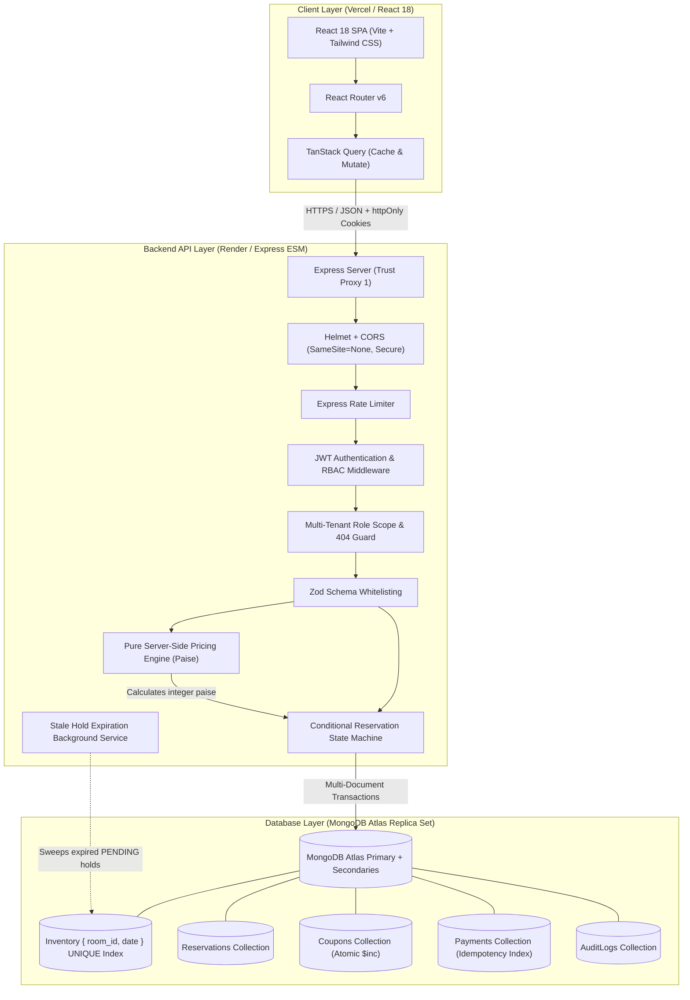
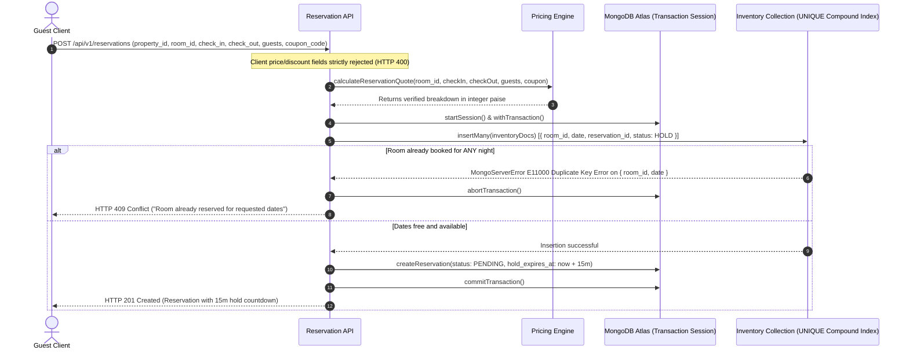
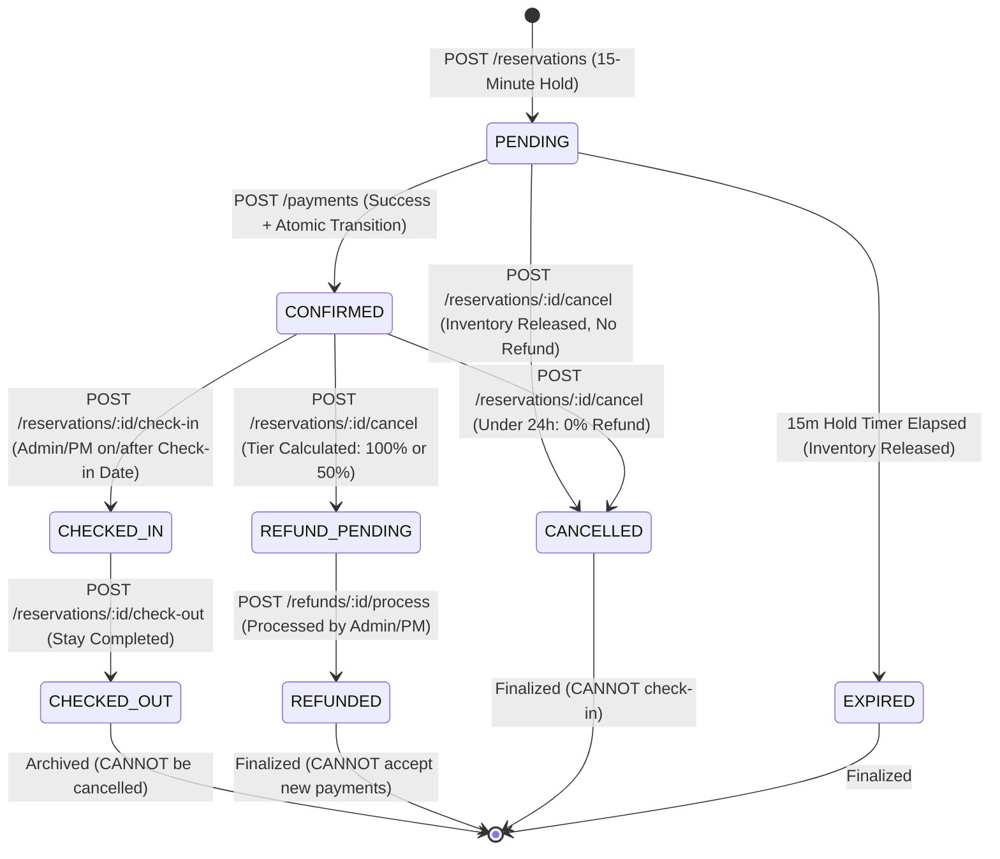

# Aura Stays – Enterprise Hotel & Resort Reservation Platform

[-00ED64?style=for-the-badge&logo=mongodb)](https://www.mongodb.com/)
[](https://react.dev/)
[-339933?style=for-the-badge&logo=node.js)](https://nodejs.org/)
[](https://www.mongodb.com/cloud/atlas)
[-brightgreen?style=for-the-badge)](https://nodejs.org/api/test.html)

Aura Stays is a high-reliability, multi-tenant Hotel, Resort & Property Reservation Management Platform designed to eliminate race conditions, double-bookings, financial discrepancies, coupon abuse, unauthorized privilege escalations, and payment duplicate transactions.

Built with clean ES Modules architecture, strict Zod schema validation, transactional MongoDB consistency, and an Airbnb/Booking.com-inspired boutique user interface.

---

## 📑 Table of Contents

1. [System Architecture](#-system-architecture)
2. [Tech Stack Breakdown](#-tech-stack-breakdown)
3. [MongoDB Atlas Setup Guide (Zero Docker)](#-mongodb-atlas-setup-guide-zero-docker)
4. [Repository Structure](#-repository-structure)
5. [Local Development & Setup](#-local-development--setup)
6. [Default Seed Accounts & Authentication](#-default-seed-accounts--authentication)
7. [The 8 Core Technical Challenges & Solutions](#-the-8-core-technical-challenges--solutions)
8. [Date Convention & Cancellation Policy Reference](#-date-convention--cancellation-policy-reference)
9. [Comprehensive API Endpoint Reference](#-comprehensive-api-endpoint-reference)
10. [Testing & Verification Guide](#-testing--verification-guide)
11. [Production Deployment Guide (Render + Vercel + Atlas)](#-production-deployment-guide-render--vercel--atlas)
12. [Post-Deployment Verification Checklist](#-post-deployment-verification-checklist)

---

## 🏛 System Architecture

### 1. High-Level Architecture Diagram



### 2. Double-Booking Prevention & Booking Sequence Flow



### 3. Reservation State Machine Lifecycle



---

## 🛠 Tech Stack Breakdown

### Backend (`/server`)
- **Runtime**: Node.js v22+ with native ES Modules (`"type": "module"`).
- **Framework**: Express.js with `helmet`, `cors`, and `express-rate-limit`.
- **Database Layer**: MongoDB Atlas Multi-Document Transactions with Mongoose ODM.
- **Authentication**: Stateless Access Tokens (15 min) + Stateful `httpOnly` Refresh Tokens (7 days) signed via `jsonwebtoken` and hashed with `bcrypt`.
- **Schema Validation**: Zod with strict key whitelisting (preventing mass assignment and price injection).
- **Structured Logging**: Pino with request-level UUID correlation tracing (`x-request-id`).
- **Currency Handling**: Integer paise arithmetic (₹1.00 = 100 paise) preventing floating-point rounding errors.

### Frontend (`/client`)
- **Build Tool**: Vite 5.
- **Library**: React 18 with React Router v6.
- **State & Server Cache**: TanStack React Query v5 (automatic query invalidation, caching, and optimistic UI updates).
- **Styling**: Tailwind CSS with custom design system (luxurious deep teal, warm gold accents, rounded-2xl cards, dark mode).
- **Component Primitives**: Radix UI (Dialog, Dropdown Menu, Select, Tabs, Popover, Alert Dialog).
- **Forms & Validation**: React Hook Form with `@hookform/resolvers/zod`.
- **Charts & Data Viz**: Recharts (Occupancy trends, revenue aggregation, bookings breakdown).
- **Animations**: Framer Motion for micro-interactions and modal transitions.
- **Notifications**: Sonner rich toasts.

---

## 🌐 MongoDB Atlas Setup Guide (Zero Docker)

This application connects to a cloud-hosted MongoDB Atlas replica set to guarantee ACID multi-document transactions without requiring Docker, docker-compose, or local database installations.

### Step 1: Create a Free Cluster on MongoDB Atlas
1. Navigate to [MongoDB Atlas](https://www.mongodb.com/cloud/atlas) and sign in.
2. Click **Create** to deploy a database.
3. Select **M0 (Shared)** free tier (or M10+ dedicated cluster).
4. Select your preferred provider (AWS / Google Cloud / Azure) and region closest to your hosting platform.
5. Click **Create Deployment**.

### Step 2: Configure Database User & Privileges
1. In the left navigation bar under **Security**, click **Database Access**.
2. Click **Add New Database User**.
3. Choose **Password** Authentication Method:
   - **Username**: `aura_admin` (or your preferred username)
   - **Password**: Enter a secure password (save this for your connection URI)
4. Under **Database User Privileges**, select **Read and write to any database** (or `readWrite` on `hotel_reservation`).
5. Click **Add User**.

### Step 3: Configure Network Access (IP Whitelist)
1. In the left navigation bar under **Security**, click **Network Access**.
2. Click **Add IP Address**.
3. Click **Allow Access from Anywhere** (`0.0.0.0/0`) so that local development and cloud platforms (Render, Vercel) can establish connectivity.
4. Click **Confirm**.

### Step 4: Obtain Connection String
1. In the left navigation bar under **Deployment**, click **Database**.
2. Click the **Connect** button next to your cluster.
3. Select **Drivers** (Node.js).
4. Copy the connection string format:
   ```
   mongodb+srv://<username>:<password>@cluster0.xxxxxx.mongodb.net/hotel_reservation?retryWrites=true&w=majority
   ```
5. Replace `<username>` and `<password>` with your database user credentials.
6. Paste this URI into `server/.env` as `MONGODB_URI`.

---

## 📁 Repository Structure

```
.
├── client/                               # Frontend React 18 Application (Vite)
│   ├── public/                           # Static assets & favicons
│   ├── src/
│   │   ├── components/                   # UI components & shared widgets
│   │   │   ├── ui/                       # Radix UI + Tailwind design primitives
│   │   │   ├── Navbar.jsx                # Global navigation with role pills & dark mode
│   │   │   ├── Footer.jsx                # Global responsive footer
│   │   │   ├── ProtectedRoute.jsx        # RBAC frontend guard (Guest/Manager/Admin)
│   │   │   ├── HoldTimer.jsx             # 15-minute live checkout hold countdown
│   │   │   └── CancellationModal.jsx     # Live refund preview before cancelling
│   │   ├── context/                      # AuthContext & ThemeContext
│   │   ├── hooks/                        # Custom React hooks
│   │   ├── lib/                          # Axios API client & paise currency formatter
│   │   ├── pages/                        # Application views (14 pages)
│   │   │   ├── LandingPage.jsx           # Hero & property search bar
│   │   │   ├── SearchResultsPage.jsx     # Room search results with filters
│   │   │   ├── RoomDetailPage.jsx        # Availability calendar & live quote widget
│   │   │   ├── CheckoutPage.jsx          # 4-step stepper with Idempotency hold
│   │   │   ├── MyBookingsPage.jsx        # Guest reservation dashboard with refund preview
│   │   │   ├── ProfilePage.jsx           # Guest profile manager
│   │   │   ├── LoginPage.jsx             # Quick one-click demo login pills
│   │   │   ├── RegisterPage.jsx          # Guest self-registration
│   │   │   └── admin/                    # Admin & Property Manager Dashboard
│   │   │       ├── AdminDashboardPage.jsx      # Recharts KPI metrics & analytics
│   │   │       ├── AdminPropertiesPage.jsx     # Multi-tenant property CRUD
│   │   │       ├── AdminRoomsPage.jsx          # Room CRUD & status management
│   │   │       ├── AdminAvailabilityPage.jsx   # Block / unblock date manager
│   │   │       ├── AdminReservationsPage.jsx   # Filtered reservation list & state actions
│   │   │       ├── AdminRefundsPage.jsx        # Refund processing queue
│   │   │       ├── AdminCouponsPage.jsx        # Promotional coupon creation
│   │   │       └── AdminAuditLogsPage.jsx      # Property-scoped compliance audit trail
│   │   ├── App.jsx                       # Router setup & query provider
│   │   └── main.jsx                      # Client mount
│   ├── .env.example                      # Client environment template
│   ├── tailwind.config.js                # Custom boutique color palette & fonts
│   └── package.json
│
├── server/                               # Backend Express API & Mongoose Layer (ESM)
│   ├── data/
│   │   └── mock_data.json                # Canonical reference seed dataset
│   ├── scripts/
│   │   └── seed.js                       # Idempotent Atlas database seeder
│   ├── src/
│   │   ├── config/
│   │   │   ├── db.js                     # Atlas Mongoose connection & index sync
│   │   │   └── env.js                    # Zod-validated server environment
│   │   ├── controllers/                  # 11 REST controllers
│   │   ├── errors/                       # Standardized AppError hierarchy
│   │   ├── middlewares/                  # Auth, RBAC, Role-scoping, Zod, Error handler
│   │   ├── models/                       # 13 Mongoose collections with compound indexes
│   │   ├── routes/                       # Express router definitions
│   │   ├── services/                     # Pricing engine, state machine, hold cleaner
│   │   ├── utils/                        # Integer currency, dates, JWT, transaction runner
│   │   ├── app.js                        # Express app config (trust proxy, helmet, cors)
│   │   └── index.js                      # Server startup & background cleaner daemon
│   ├── tests/                            # 17 Test Suites (125 tests)
│   ├── .env.example                      # Server environment template
│   └── package.json
│
├── scripts/                              # Standalone Verification Scripts
│   ├── concurrency-test.js               # 6 Concurrency & Race Condition Scenarios
│   └── security-test.js                  # 13 Security, IDOR & Authorization Scenarios
│
├── .gitignore                            # Excludes .env, node_modules, dist, logs
├── package.json                          # Unified root runner (dev, seed, test, scripts)
└── README.md                             # Exhaustive engineering documentation
```

---

## 💻 Local Development & Setup

### Prerequisites
- **Node.js**: v20+ or v22+
- **npm**: v10+
- **MongoDB Atlas**: Free cluster connection URI

### 1. Clone the Repository
```bash
git clone <repository-url>
cd DHassignment
```

### 2. Configure Environment Variables

Create `.env` inside `server/` using `server/.env.example`:
```bash
# server/.env
MONGODB_URI=mongodb+srv://<username>:<password>@cluster0.xxxxxx.mongodb.net/hotel_reservation?retryWrites=true&w=majority
JWT_SECRET=super_secret_jwt_access_key_min_32_characters_long_dh_2026
JWT_REFRESH_SECRET=super_secret_jwt_refresh_key_min_32_characters_long_dh_2026
PORT=5000
NODE_ENV=development
CLIENT_URL=http://localhost:5173
```

Create `.env` inside `client/` using `client/.env.example`:
```bash
# client/.env
VITE_API_URL=http://localhost:5000/api/v1
VITE_API_BASE_URL=/api/v1
```

### 3. Install Dependencies
```bash
npm install
npm --prefix server install
npm --prefix client install
```

### 4. Seed the MongoDB Atlas Database
Run the idempotent database seeder to populate canonical users, properties, rooms, pricing, and coupons:
```bash
npm run seed
```

### 5. Start Both Server and Client Concurrently
```bash
npm run dev
```
- **Backend API**: `http://localhost:5000/api/v1`
- **Frontend App**: `http://localhost:5173`

---

## 👥 Default Seed Accounts & Authentication

All seed accounts share the unified master password: `Password@123`. The frontend login page includes quick one-click pills to log in immediately as any of these roles:

| Role | Email | Password | Scope & Managed Entities |
| :--- | :--- | :--- | :--- |
| **ADMIN** | `admin@example.com` | `Password@123` | Full unrestricted access across all properties, rooms, reservations, reports, and global audit logs. |
| **PROPERTY_MANAGER** | `manager1@example.com` | `Password@123` | Scoped exclusively to **The Grand Palace (PROP-001)** in Mumbai. Cannot access or view Goa properties. |
| **PROPERTY_MANAGER** | `manager2@example.com` | `Password@123` | Scoped exclusively to **Oceanfront Resort & Spa (PROP-002)** in Goa. Cannot access or view Mumbai properties. |
| **GUEST** | `guest1@example.com` | `Password@123` | Guest 1 (Aarav Patel). Scoped exclusively to own reservations (`RES-001`, `RES-005`), payments, and refunds. |
| **GUEST** | `guest2@example.com` | `Password@123` | Guest 2 (Priya Sharma). Scoped exclusively to own reservation (`RES-002`). |
| **GUEST** | `guest3@example.com` | `Password@123` | Guest 3 (Rohan Verma). Scoped exclusively to own reservation (`RES-003`). |

---

## ⚡ The 8 Core Technical Challenges & Solutions

### 1. Double-Booking Prevention: `Inventory` Unique Compound Index
- **The Problem**: Traditional systems perform a "check availability query, then insert booking". Under concurrent load (e.g. 25 guests booking the same room at the same millisecond), both read queries see the room as available (Time-of-Check to Time-of-Use / TOCTOU bug), creating double-bookings.
- **The Solution**: Direct inventory document insertion within a MongoDB replica set multi-document transaction (`Inventory.insertMany(docs, { session })`).
- **Index Constraint**: A compound **UNIQUE index** on `{ room_id: 1, date: 1 }`.
- **Handling**: If any night in the requested range collides with an existing reservation or blocked date, MongoDB Atlas immediately rejects the write with `E11000 Duplicate Key`. The transaction aborts cleanly, and the server returns **HTTP 409 Conflict** (`ROOM_ALREADY_BOOKED`).

### 2. Atomic Coupon Increments & Usage Limits
- **The Problem**: Concurrently redeeming a limited-usage coupon (e.g. `usage_limit: 2`) allows 10 concurrent requests to pass standard read checks before the count is updated, resulting in coupon exploitation.
- **The Solution**: Atomic `findOneAndUpdate` combined with multi-document transactions:
  ```javascript
  const coupon = await Coupon.findOneAndUpdate(
    {
      code: coupon_code.toUpperCase(),
      status: 'ACTIVE',
      valid_from: { $lte: now },
      valid_until: { $gte: now },
      $expr: { $lt: ['$used_count', '$usage_limit'] }
    },
    { $inc: { used_count: 1 } },
    { session, new: true }
  );
  ```
  If `used_count` equals `usage_limit`, the query matches 0 documents and fails atomically. Customer-restricted coupons and per-customer limits are checked within the same transactional boundary.

### 3. Conditional State Machine Transitions
- **The Problem**: Stale webhooks or out-of-order API requests causing invalid transitions (e.g., checking in a cancelled reservation, or refunding a completed stay).
- **The Solution**: Strict state transition matrix in `reservationStateMachine.js`. Every status update executes a conditional atomic update:
  ```javascript
  const updated = await Reservation.findOneAndUpdate(
    { reservation_id, status: expectedCurrentStatus },
    { status: newStatus, ...metadata },
    { session, new: true }
  );
  ```
  If the reservation is not in the exact expected prior state, the update returns `null` and the API rejects the request with **HTTP 409 Conflict** (`INVALID_STATE_TRANSITION`).

### 4. Payment Idempotency with Replay Cache
- **The Problem**: Network timeouts causing users or browsers to resubmit payments, leading to duplicate credit card charges.
- **The Solution**: Strict `Idempotency-Key` header requirement on `POST /api/v1/payments`:
  - A unique index on `payments.idempotency_key`.
  - When a key is received, the server checks if a payment already exists for this key.
  - If found, it immediately replays the original cached response with identical status and payload without charging again.
  - Parallel payment attempts with different keys for the same reservation are rejected because the reservation's status is atomically locked from `PENDING` to `CONFIRMED`.

### 5. Multi-Tier Cancellation & Live Refund Preview
- **The Problem**: Dispute over refund amounts upon cancellation and discrepancies between user expectations and backend charges.
- **The Solution**: Pure server-side cancellation policy calculated from check-in UTC time:
  - `GET /api/v1/reservations/:id/cancellation-preview`: Returns exact calculation before user confirms.
  - **Tier 1 (>= 48h before check-in)**: 100% refund, 0% cancellation fee.
  - **Tier 2 (24h to 48h before check-in)**: 50% refund, 50% cancellation fee.
  - **Tier 3 (< 24h before check-in)**: 0% refund, 100% cancellation fee.
  - Cancelling instantly deletes associated `Inventory` documents, releasing the room back into search availability.

### 6. Pure Server-Side Pricing Engine in Integer Paise
- **The Problem**: Floating-point math bugs (e.g. `0.1 + 0.2 = 0.30000000000000004`) and client-side price tampering via manipulated payloads.
- **The Solution**:
  - All currency is stored and calculated as integers in **paise** (₹1 = 100 paise).
  - Client payloads with `price`, `discount`, `tax`, `total_amount`, or `service_fee` are rejected with **HTTP 400 Bad Request** via strict Zod whitelisting.
  - Pure calculation order: `Base Price` -> `Seasonal Override (RoomPricing)` -> `Weekend Surcharge (Fri/Sat +20%)` -> `Extra Guest Surcharge` -> `Coupon Discount` -> `12% GST Tax` -> `Flat Service Fee (₹500.00)`.

### 7. Multi-Tenant Property Manager Scoping & IDOR 404 Guard
- **The Problem**: Insecure Direct Object References (IDOR) where a manager accesses another property's private bookings, or a guest learns about other reservations via HTTP 403 status codes (entity enumeration).
- **The Solution**:
  - Identity is derived strictly from verified JWT tokens.
  - `PROPERTY_MANAGER` queries are filtered with `{ property_id: { $in: managedPropertyIds } }`.
  - **The 404 Anti-Enumeration Rule**: When an unauthorized guest attempts to read another user's reservation, payment, or refund, the API returns **HTTP 404 Not Found** (never 403 Forbidden). Attackers cannot probe for the existence of business IDs.

### 8. 15-Minute Hold Timer & Daemon Background Cleanup
- **The Problem**: Guests initiating checkout and abandoning carts, permanently locking rooms and preventing other paying customers from booking.
- **The Solution**:
  - Reservations are created with `status: 'PENDING'` and `hold_expires_at = Date.now() + 15 * 60 * 1000`.
  - A background cleaner daemon sweeps every 60 seconds (and lazily runs on room search queries).
  - Stale reservations transition to `EXPIRED`, and their inventory documents are deleted atomically, restoring availability.
  - The checkout UI provides a real-time synchronized hold countdown timer.

---

## 📅 Date Convention & Cancellation Policy Reference

### Date Interval & Overlap Convention
- **Check-in is INCLUSIVE, check-out is EXCLUSIVE**:
  - A reservation from `2026-09-20` to `2026-09-25` occupies exactly 5 nights: `Sep 20, 21, 22, 23, 24`.
  - A subsequent reservation starting on `2026-09-25` does **NOT** conflict.
- **Normalization**: All dates are normalized to UTC midnight (`00:00:00.000Z`).
- **Validation**:
  - Rejects `check_out <= check_in`.
  - Rejects past check-in dates.
  - Rejects stays exceeding 30 nights.

### Cancellation Refund Policy Matrix

| Cancellation Window | Refund Percentage | Cancellation Fee | Automatic Refund Document Created |
| :--- | :--- | :--- | :--- |
| **48+ Hours Before Check-in** | **100% of Total Amount** | ₹0.00 (0%) | Yes (`status: PENDING`, ready for processing) |
| **24 to 48 Hours Before Check-in** | **50% of Total Amount** | 50% of Total Amount | Yes (`status: PENDING`, ready for processing) |
| **Under 24 Hours / No Show** | **0% Refund** | 100% of Total Amount | No refund record created |

---

## 📡 Comprehensive API Endpoint Reference

### Public Endpoints (No Token Required)
| Method | Endpoint | Description |
| :--- | :--- | :--- |
| `GET` | `/api/v1/properties` | List all active properties. Supports filtering by `city`, `property_type`, `state`. |
| `GET` | `/api/v1/properties/:id` | Retrieve single property details and associated room types. |
| `GET` | `/api/v1/rooms/search` | Search available rooms by `property_id`, `check_in`, `check_out`, and `guests`. |
| `POST` | `/api/v1/reservations/quote` | Calculate real-time, tamper-proof server-side price breakdown. |
| `POST` | `/api/v1/auth/register` | Register new `GUEST` account (creates `User` + `Guest` profile). |
| `POST` | `/api/v1/auth/login` | Authenticate with email and password; returns 15m access token and sets 7d httpOnly refresh cookie. |
| `POST` | `/api/v1/auth/refresh` | Exchange httpOnly refresh cookie for a new 15m access token. |
| `POST` | `/api/v1/auth/logout` | Invalidate session and clear refresh cookie. |

### Authenticated Guest Endpoints (`Bearer <token>`)
| Method | Endpoint | Description |
| :--- | :--- | :--- |
| `GET` | `/api/v1/auth/me` | Retrieve profile and role of authenticated user. |
| `GET` | `/api/v1/guests/me` | Retrieve guest profile details (name, phone, address). |
| `PATCH` | `/api/v1/guests/me` | Update guest profile information. |
| `POST` | `/api/v1/reservations` | Create reservation with 15-minute hold. Enforces unique inventory index. |
| `GET` | `/api/v1/reservations` | List authenticated guest's reservations. |
| `GET` | `/api/v1/reservations/:id` | Get reservation details (returns 404 for unowned reservations). |
| `GET` | `/api/v1/reservations/:id/cancellation-preview` | Live calculation of refund tier before cancelling. |
| `POST` | `/api/v1/reservations/:id/cancel` | Cancel reservation and release inventory. |
| `POST` | `/api/v1/payments` | Process payment with `Idempotency-Key` header. Locks reservation to CONFIRMED. |
| `GET` | `/api/v1/payments` | List authenticated guest's payments. |
| `GET` | `/api/v1/payments/:id` | Get payment details (returns 404 for unowned payments). |
| `GET` | `/api/v1/refunds` | List authenticated guest's refunds. |
| `GET` | `/api/v1/refunds/:id` | Get refund details (returns 404 for unowned refunds). |

### Admin & Property Manager Endpoints (`Bearer <token>`, Scoped)
| Method | Endpoint | Roles | Description |
| :--- | :--- | :--- | :--- |
| `POST` | `/api/v1/admin/properties` | `ADMIN` | Create new property. |
| `GET` | `/api/v1/admin/properties` | `ADMIN`, `PROPERTY_MANAGER` | List properties (PM sees only managed properties). |
| `GET` | `/api/v1/admin/properties/:id` | `ADMIN`, `PROPERTY_MANAGER` | Get property details (404 for unmanaged). |
| `PATCH` | `/api/v1/admin/properties/:id` | `ADMIN`, `PROPERTY_MANAGER` | Update property details (PM can update managed property). |
| `DELETE` | `/api/v1/admin/properties/:id` | `ADMIN` | Delete property. |
| `POST` | `/api/v1/admin/room-types` | `ADMIN`, `PROPERTY_MANAGER` | Create room type for managed property. |
| `GET` | `/api/v1/admin/room-types` | `ADMIN`, `PROPERTY_MANAGER` | List room types scoped by manager properties. |
| `POST` | `/api/v1/admin/rooms` | `ADMIN`, `PROPERTY_MANAGER` | Create physical room. |
| `GET` | `/api/v1/admin/rooms` | `ADMIN`, `PROPERTY_MANAGER` | List rooms with filters and pagination. |
| `PATCH` | `/api/v1/admin/rooms/:id` | `ADMIN`, `PROPERTY_MANAGER` | Update room status (`ACTIVE`, `INACTIVE`, `MAINTENANCE`). |
| `POST` | `/api/v1/admin/rooms/:id/block` | `ADMIN`, `PROPERTY_MANAGER` | Block room dates by inserting `BLOCKED` inventory documents. |
| `POST` | `/api/v1/admin/rooms/:id/unblock` | `ADMIN`, `PROPERTY_MANAGER` | Unblock dates by deleting inventory documents. |
| `POST` | `/api/v1/admin/room-pricing` | `ADMIN`, `PROPERTY_MANAGER` | Create seasonal pricing period (rejects 409 on overlap). |
| `GET` | `/api/v1/admin/room-pricing` | `ADMIN`, `PROPERTY_MANAGER` | List seasonal pricing rules. |
| `POST` | `/api/v1/admin/coupons` | `ADMIN`, `PROPERTY_MANAGER` | Create promotional coupon. |
| `GET` | `/api/v1/admin/coupons` | `ADMIN`, `PROPERTY_MANAGER` | List coupons (manager sees only property-applicable). |
| `GET` | `/api/v1/admin/reservations` | `ADMIN`, `PROPERTY_MANAGER` | List reservations with status, date, and search filters. |
| `POST` | `/api/v1/reservations/:id/check-in` | `ADMIN`, `PROPERTY_MANAGER` | Check-in guest on or after scheduled check-in date. |
| `POST` | `/api/v1/reservations/:id/check-out` | `ADMIN`, `PROPERTY_MANAGER` | Check-out guest and conclude stay. |
| `POST` | `/api/v1/refunds/:id/process` | `ADMIN`, `PROPERTY_MANAGER` | Process pending refund back to guest. |
| `GET` | `/api/v1/admin/reports/occupancy` | `ADMIN`, `PROPERTY_MANAGER` | Aggregation: Occupancy rate by property and date range. |
| `GET` | `/api/v1/admin/reports/revenue` | `ADMIN`, `PROPERTY_MANAGER` | Aggregation: Daily or monthly revenue aggregation. |
| `GET` | `/api/v1/admin/reports/bookings` | `ADMIN`, `PROPERTY_MANAGER` | Aggregation: Total bookings count & cancellation rate. |
| `GET` | `/api/v1/admin/reports/coupons` | `ADMIN`, `PROPERTY_MANAGER` | Aggregation: Coupon usage count & total discount given. |
| `GET` | `/api/v1/admin/reports/kpi` | `ADMIN`, `PROPERTY_MANAGER` | Executive KPI dashboard summary metrics. |
| `GET` | `/api/v1/admin/audit-logs` | `ADMIN`, `PROPERTY_MANAGER` | Audit logs (Admin sees all; PM sees managed properties). |

---

## 🧪 Testing & Verification Guide

### 1. Run the Full Backend Test Suite (125 Tests, 17 Suites)
Runs all unit and integration tests against the live Atlas replica set:
```bash
npm test
```
**Test Coverage Includes:**
- Suite 1: Authentication & RBAC (Self-registration guards, token lifecycles, 404 anti-enumeration).
- Suite 2: Date Interval & Overlap Logic (Enclosure, partial overlap, adjacent stays, 30-night cap).
- Suite 3: Pure Pricing Engine (Seasonal overrides, weekend surcharges, extra guests, taxes, discounts).
- Suite 4: Availability & Concurrency (20 parallel requests for same room, hold expiration).
- Suite 5: Coupons & Payments (Atomic redemption, idempotency key replay, 10 parallel payments race).
- Suite 6: State Machine Lifecycle (Check-in/out, multi-tier refund calculation, 10 parallel refunds race).
- Suite 7: Admin & Multi-Tenant Scoping (Cross-manager 404 isolation, reporting aggregations, audit logs).

```
# tests 125
# suites 17
# pass 125
# fail 0
```

### 2. Run High-Concurrency Stress Test
Stress-tests concurrent race conditions against MongoDB Atlas:
```bash
npm run test:concurrency
```
**Scenarios Tested:**
1. **25 Parallel Bookings**: 25 concurrent requests for the exact same room and dates -> **Exactly 1 succeeds (201 Created)**, **24 rejected (409 Conflict)**.
2. **Overlapping-Date Parallel Bookings**: 5 concurrent bookings with overlapping date ranges -> **Exactly 1 succeeds**, **4 return 409 Conflict**.
3. **Parallel Coupon Redemption at Usage Limit**: 8 parallel requests for a coupon with `usage_limit: 2` -> **Exactly 2 succeed**, **6 rejected**.
4. **Payment Replay with Idempotency-Key**: Replaying the same key -> **Cached response returned with identical status and ID**.
5. **Parallel Payments with Different Keys**: 5 concurrent payments with different keys for 1 reservation -> **Exactly 1 succeeds**, **4 rejected**.
6. **Parallel Refund Processing**: 10 concurrent refund process calls -> **Idempotent: all 10 resolve cleanly with HTTP 200 without duplicate charges**.

### 3. Run Security & Authorization Test
Tests defensive boundaries, IDOR resistance, and role enforcement:
```bash
npm run test:security
```
**Scenarios Tested:**
1. Tampered price, discount, tax, total, or service fee in booking payload (HTTP 400).
2. Tampered refund fields in cancellation payload (HTTP 400).
3. Expired coupon application (HTTP 400).
4. Booking an inactive or maintenance room (HTTP 404).
5. Exceeding room maximum capacity (HTTP 400).
6. IDOR on reservations: Guest 2 querying Guest 1 reservation returns **HTTP 404 (NEVER 403)**.
7. IDOR on payments: Guest 2 querying Guest 1 payment returns **HTTP 404 (NEVER 403)**.
8. IDOR on refunds: Guest 2 querying Guest 1 refund returns **HTTP 404 (NEVER 403)**.
9. Guest calling admin endpoints receives **HTTP 403 Forbidden**.
10. Manager 1 accessing Manager 2's property returns **HTTP 404 Not Found**.
11. Invalid state transitions (e.g. `PENDING` -> `CHECKED_IN`) rejected with **HTTP 409 Conflict**.
12. Checking in a cancelled reservation rejected with **HTTP 409 Conflict**.
13. Cancelling a checked-out completed reservation rejected with **HTTP 409 Conflict**.

---

## 🚀 Production Deployment Guide (Render + Vercel + Atlas)

This application is architected for zero-Docker, zero-AWS production deployment using **Render** for the backend API, **Vercel** for the frontend SPA, and **MongoDB Atlas** for the database.

### Architecture Topology
- **Database**: MongoDB Atlas (`mongodb+srv://...`)
- **Backend API**: Render Web Service (`https://aura-stays-api.onrender.com`)
- **Frontend SPA**: Vercel (`https://aura-stays.vercel.app`)

---

### Part 1: Deploy Backend to Render

1. Log in to [Render](https://render.com/) and click **New +** -> **Web Service**.
2. Connect your Git repository.
3. Configure the Web Service settings:
   - **Name**: `aura-stays-api`
   - **Region**: Choose the region closest to your MongoDB Atlas cluster.
   - **Root Directory**: `server`
   - **Environment**: `Node`
   - **Build Command**: `npm install`
   - **Start Command**: `node src/index.js`
4. Add the **Environment Variables**:
   | Variable | Recommended Value | Notes |
   | :--- | :--- | :--- |
   | `NODE_ENV` | `production` | Enables production cookie flags and logging |
   | `PORT` | `5000` | Render will bind to this port |
   | `MONGODB_URI` | `mongodb+srv://<user>:<password>@cluster.mongodb.net/hotel_reservation?retryWrites=true&w=majority` | Atlas connection string |
   | `JWT_SECRET` | *(generate a random 64-char string)* | Access token signing secret |
   | `JWT_REFRESH_SECRET` | *(generate a random 64-char string)* | Refresh token signing secret |
   | `CLIENT_URL` | `https://aura-stays.vercel.app` | **CRITICAL**: Set to your Vercel frontend URL |

5. **Trust Proxy & Cookie Configuration (Already Implemented)**:
   - The backend in `server/src/app.js` is pre-configured with `app.set('trust proxy', 1)` so that Express honors Render's reverse proxy SSL headers.
   - Refresh cookies in `server/src/utils/jwt.js` automatically use:
     ```javascript
     sameSite: isProd ? 'none' : 'lax',
     secure: isProd,
     httpOnly: true
     ```
     This enables secure cross-domain cookie transmission between your Vercel frontend domain (`*.vercel.app`) and Render backend domain (`*.onrender.com`).

---

### Part 2: Deploy Frontend to Vercel

1. Log in to [Vercel](https://vercel.com/) and click **Add New...** -> **Project**.
2. Import your Git repository.
3. In the project configuration modal:
   - **Framework Preset**: `Vite`
   - **Root Directory**: Click **Edit** and select `client`
   - **Build Command**: `npm run build`
   - **Output Directory**: `dist`
4. Add the **Environment Variables**:
   | Variable | Value | Description |
   | :--- | :--- | :--- |
   | `VITE_API_URL` | `https://aura-stays-api.onrender.com/api/v1` | URL of your deployed Render backend |
5. Click **Deploy**.

---

### Part 3: Configure CORS & Cross-Origin Cookies

Once Vercel assigns your production URL (e.g. `https://aura-stays.vercel.app`):
1. Go back to Render -> `aura-stays-api` -> **Environment**.
2. Update `CLIENT_URL` to match your exact Vercel production domain:
   ```
   CLIENT_URL=https://aura-stays.vercel.app
   ```
3. Click **Save Changes** (Render will automatically redeploy with the updated CORS whitelist).

---

## ✅ Post-Deployment Verification Checklist

After deploying to Render, Vercel, and Atlas, verify each step:

- [ ] **Database Connectivity**: Open Render Web Service logs and verify the entry: `✅ MongoDB Connected: <cluster-shard>.mongodb.net/hotel_reservation`.
- [ ] **Database Seeding**: In Render, run a one-off shell or run locally targeting the production Atlas cluster: `npm run seed`.
- [ ] **Health Check**: Open `https://aura-stays-api.onrender.com/api/v1/properties` in your browser. It should return a `200 OK` JSON response with active properties.
- [ ] **Cross-Domain Authentication**:
  - Open `https://aura-stays.vercel.app/login`.
  - Click the **Guest 1** pill and log in.
  - Inspect Developer Tools -> Application -> Cookies: Verify the `refreshToken` cookie is present with `HttpOnly`, `Secure`, and `SameSite=None`.
- [ ] **Booking Flow**: Complete a booking for a future date, apply coupon `WELCOME10`, and complete payment.
- [ ] **Hold Countdown**: Initiate a booking and confirm the 15-minute countdown timer displays properly.
- [ ] **Cancellation Preview**: View the booking in **My Bookings**, open the cancellation modal, and verify the refund tier preview shows ₹ amount and 100%/50%/0% accurately.
- [ ] **Admin Scoping**: Log in as `manager1@example.com` and verify only Mumbai properties and bookings are accessible.
- [ ] **Remote Concurrency Test**: Run the concurrency test script against your production backend:
  ```bash
  BASE_URL=https://aura-stays-api.onrender.com/api/v1 npm run test:concurrency
  ```
  Ensure all 6 tests pass against production.
- [ ] **Remote Security Test**: Run the security test script against your production backend:
  ```bash
  BASE_URL=https://aura-stays-api.onrender.com/api/v1 npm run test:security
  ```
  Ensure all 13 tests pass against production.

---

## 📄 License
ISC License. Built for enterprise reliability and modern boutique hotel reservation operations.
